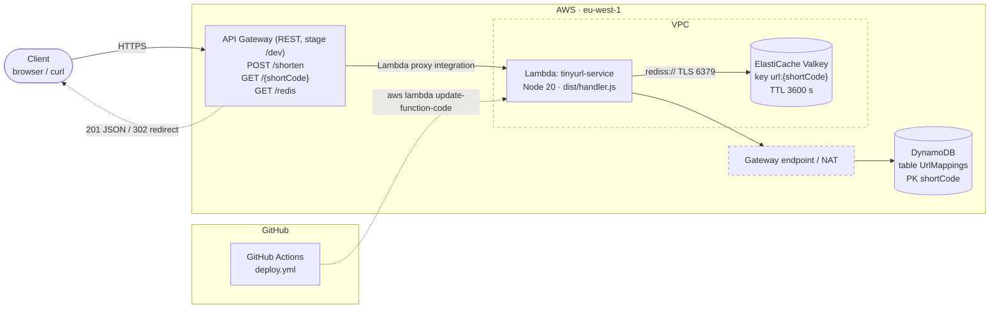
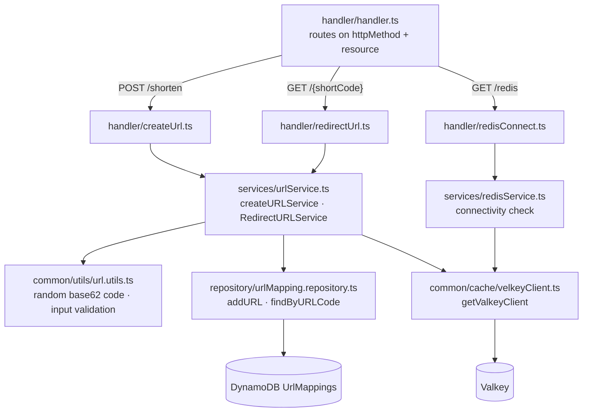
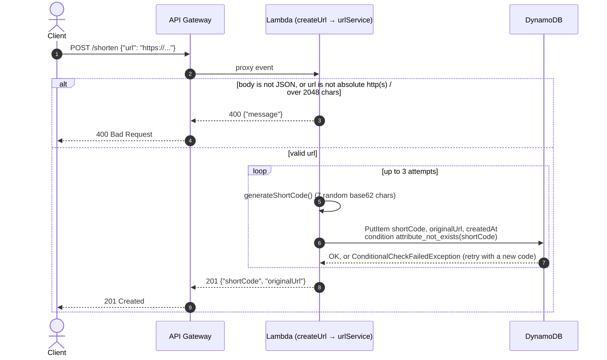
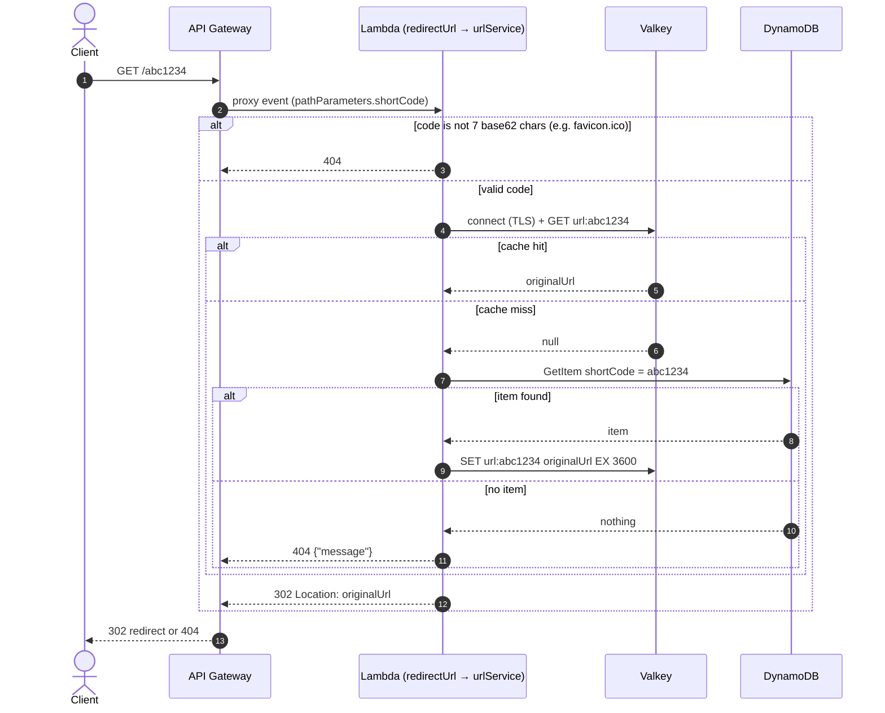
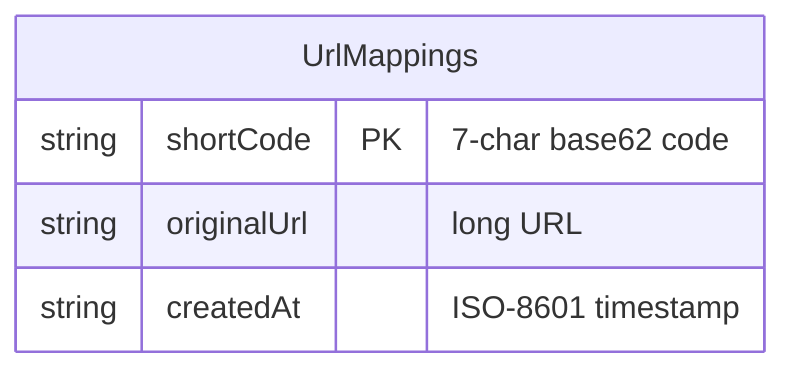
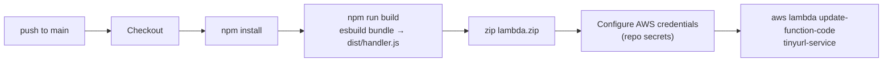

# TinyURL Architecture

A serverless URL shortener on AWS (eu-west-1). A single Lambda function sits behind API Gateway. DynamoDB is the source of truth, and an ElastiCache Valkey cluster acts as a read-through cache on the redirect path.

> Infrastructure (API Gateway, VPC, ElastiCache, DynamoDB table, IAM) is not defined in this repo. Dashed nodes below are inferred from AWS constraints.

## System overview

## Code structure inside the Lambda

The bundle uses a layered structure: router → handler → service → repository or cache client.

## Create short URL: `POST /shorten`

## Redirect: `GET /{shortCode}`

## Data model

| Store | Key | Value | Written | Expiry |
|---|---|---|---|---|
| DynamoDB `UrlMappings` | `shortCode` | `originalUrl`, `createdAt` | On create (conditional put, retried on conflict) | None |
| Valkey | `url:{shortCode}` | original URL string (unknown codes are not cached) | On redirect cache miss | 3600 s |

## Deployment pipeline

